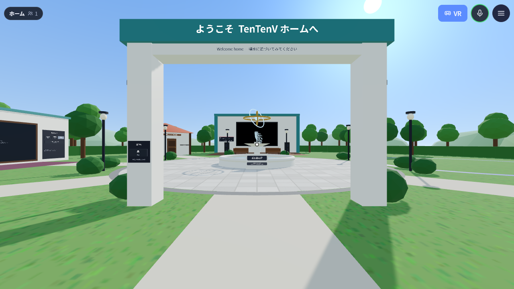
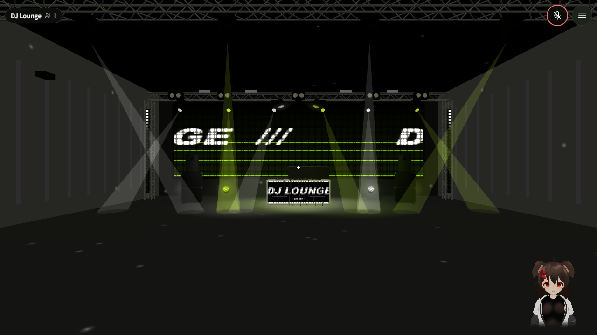
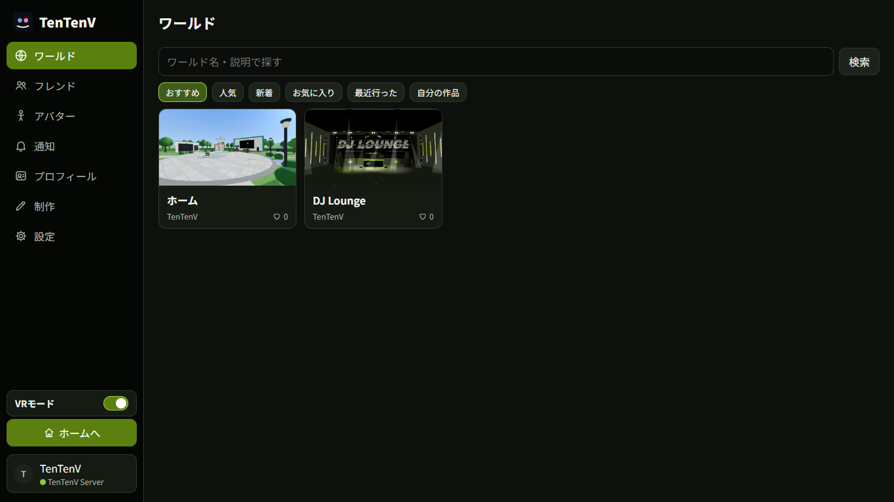
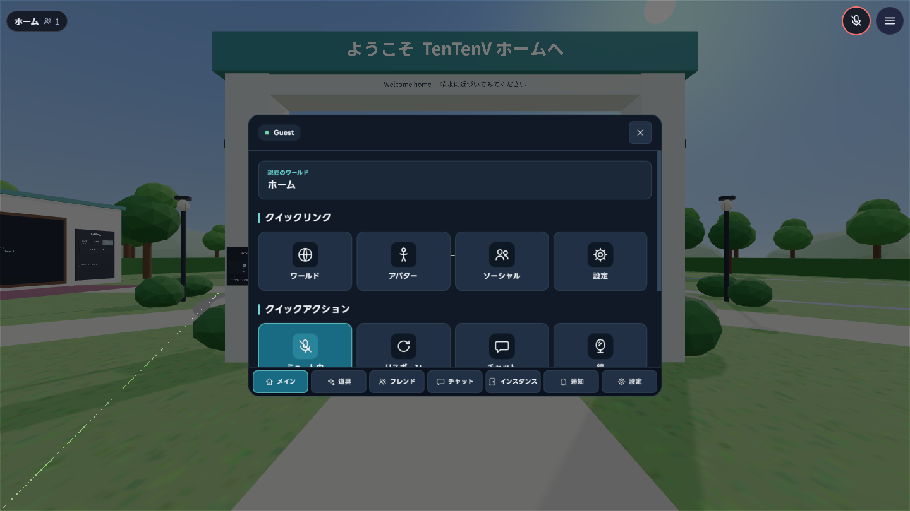
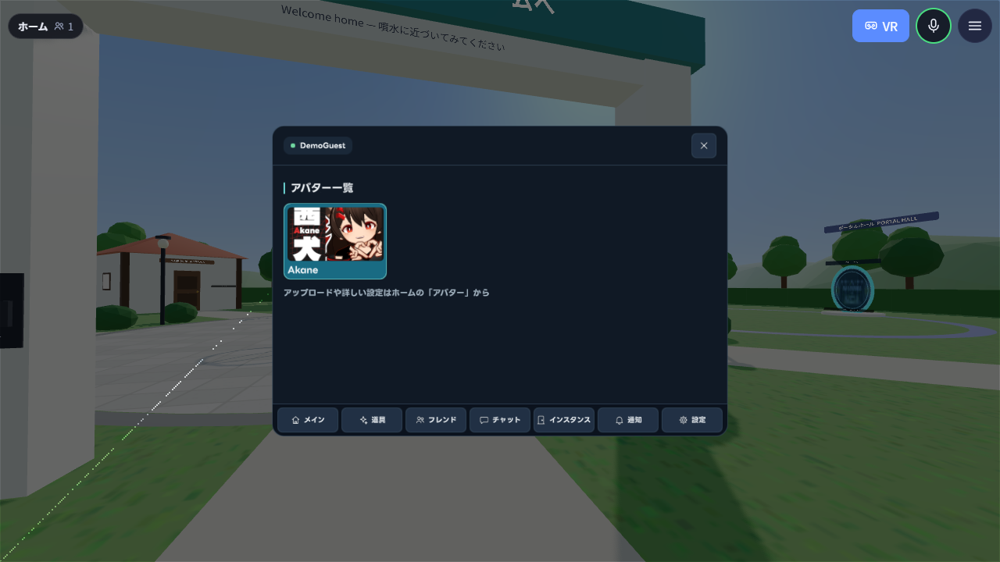
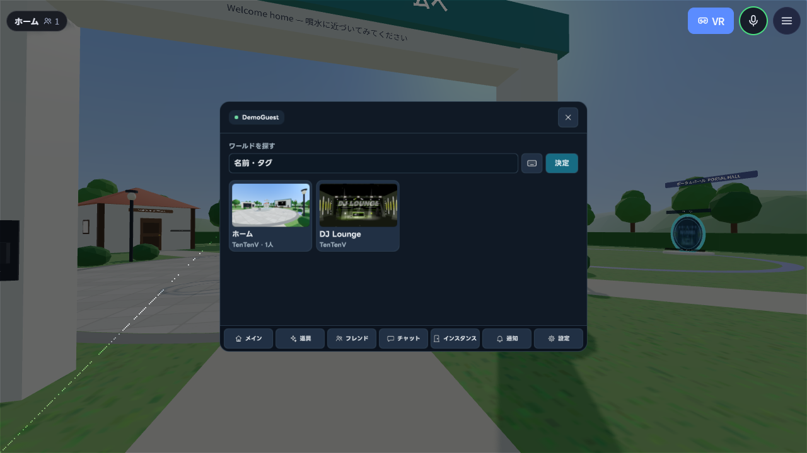
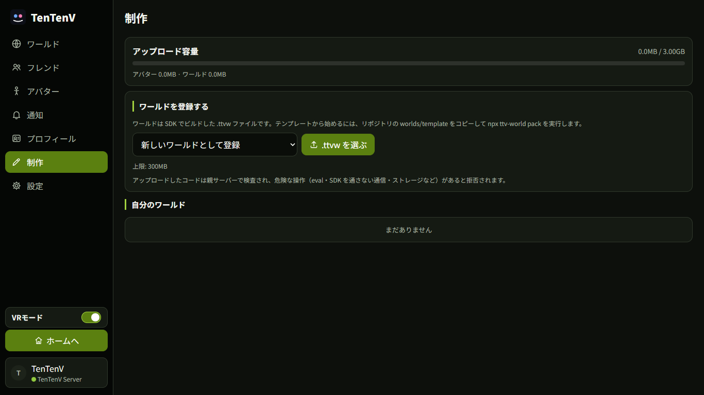
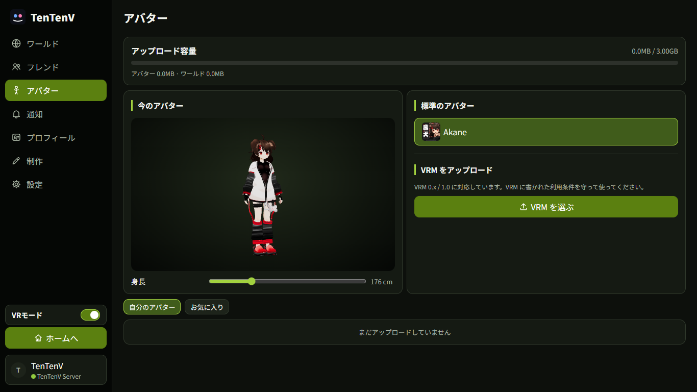

# TenTenV — VRSNS 向け WebXR フレームワーク

TenTenV（テンテンブイ）は、ソーシャル VR（VRSNS）をブラウザで動かすための、オープンソースで分散型の WebXR フレームワークです。親サーバー・クライアント・ワールド SDK・Windows 版をひとそろいで含み、そのまま自分たちの VRSNS として立ち上げられます。ブラウザだけで動き、VR ヘッドセット・PC・スマートフォンから同じワールドに集まれます。three.js / React Three Fiber / WebXR を使い、クライアント・サーバー・SDK はすべて TypeScript で書かれています。

[Windows 版の最新版をダウンロード](https://github.com/KinuX2/TenTenV/releases/latest)

誰でも自分の「親サーバー」を立てられ、利用者は接続する親サーバーを選びます。参加者どうしは P2P（WebRTC）で直接つながるので、親サーバーが止まっても、すでに同じ部屋にいる人とはそのまま遊び続けられます。

## デモプレイ動画

ホームワールド内の移動とメニュー操作を収録した約 12 秒の動画です。

https://github.com/user-attachments/assets/9b1257e3-23a7-4210-9783-99f6265c59aa

[MP4 ファイルをダウンロード](https://github.com/KinuX2/TenTenV/releases/download/v0.1.10/demo-play.mp4)

## スクリーンショット

| ホームワールド | DJ Lounge |
|---|---|
|  |  |
| ワールド一覧 | ワールド内メニュー |
|  |  |
| アバター一覧 | ワールドメニュー |
|  |  |
| 制作とアップロード容量 | アバターとアップロード容量 |
|  |  |

## 特長

- **いろいろな端末で**: WebXR 対応の VR ヘッドセット、PC（キーボード・マウス、ゲームパッド）、スマホ（タッチ操作）。VR ではコントローラーとハンドトラッキングに対応します。
- **VRM アバター**: 標準アバターは CC0 の「Akane」（作者: 赤山みんと 様）。VRM 0.x / 1.0 をアップロードして使えます。頭と両手の 3 点から全身を動かす IK（逆運動学: 手や頭の位置から腕や体の曲げ方を計算する方法）、揺れもの（SpringBone）、表情・ジェスチャー、声に合わせた口の動き、寝るポーズ。VRM に書かれた利用条件を表示します。
- **アップロード容量**: アバターとワールドで共通の 3GB 枠を使います。制作・アバター画面で使用量を確認でき、上限は親サーバー側でも確認します。
- **トラッキング**: Windows 版（OpenXR）で腰・両足のトラッキングと、コントローラーを持ったままの指の動きに対応します。表情は OSC で受け取り、VMC と `/avatar/parameters`、ARKit 系のパラメーター名に対応します。
- **画面と VR で同じメニュー**: ワールドの中のメニューは [uikit](https://github.com/pmndrs/uikit) の 3D の UI で、画面でも VR でも同じ部品をそのまま描きます（画面ではカメラの前いっぱい、VR では目の前の空間に置くだけが違う）。
- **P2P のフルメッシュ**: 1 つのインスタンス（部屋）の全員が WebRTC で直接つながります。P2P がつながらない相手には、親サーバーの WebSocket がデータを中継し、声も Opus に圧縮して中継します（ブラウザの WebCodecs を使用）。
- **独立した親サーバー**: 親サーバーごとにアカウント・フレンド・ワールドは別々です。親サーバーが署名した参加チケット（Ed25519）を参加者どうしで確かめるので、親サーバーなしでもホストの引き継ぎができます。
- **Misskey でログイン**: Misskey の MiAuth を使い、パスワードを親サーバーに渡しません。ゲストログインもあります（サーバー設定で無効にできます）。
- **ワールド SDK**: React のフックと部品で、押せる物・つかめる物・椅子・鏡・動画・ポータル・同期する状態・保存するデータなどを作れます。
- **安全のしくみ**: ミュート・アバターの非表示・ブロック・通報、接触の許可、重すぎるアバターの自動差し替え、ワールドのコードの静的検査とファイルの SHA-256 照合。

## 必要なもの

- Node.js 22.13 以上（24 を推奨）。親サーバーは Node 標準の `node:sqlite` を使うので、データベースを別に入れる必要はありません。
- 新しめのブラウザ（Chrome / Edge / Firefox / Safari）。VR には WebXR 対応のブラウザ（Quest のブラウザなど）が必要です。

## Docker Compose で起動

リポジトリのルートで次を実行します。初回はアプリと標準ワールドをビルドします。

```sh
docker compose up --build -d
```

ブラウザで http://localhost:8787 を開けます。Windows クライアントからも同じアドレスに接続できます。状態は `docker compose ps`、ログは `docker compose logs -f server` で確認できます。停止は `docker compose down` です。利用者・ワールド・鍵は Docker volume に残ります。

設定を変えるときは `.env.example` を `.env` にコピーして、待受アドレス・ホスト側ポート・公開 URL を編集します。サーバー名、ゲストログイン、アップロード、人数制限などは [deploy/compose.config.json](deploy/compose.config.json) を編集します。設定変更後は `docker compose up -d --force-recreate` で反映します。公開 URL には利用者から到達できるアドレスを指定してください。インターネット公開時は HTTPS のリバースプロキシを使用し、設定JSONの `trustProxy` を `true` にします。

既存データを消す操作は `docker compose down -v` です。バックアップ時は volume 内の SQLite データベースと鍵も保存してください。

## はじめかた（開発）

```sh
npm install
npm run seed         # 標準のワールド（ホーム・DJ ラウンジ）をビルドして apps/server/seed/ に置く
npm run dev:server   # 親サーバー（http://localhost:8787、ファイルを変えると再起動）
npm run dev:client   # 別のターミナルで。クライアント（http://localhost:5190）
```

ブラウザで http://localhost:5190 を開き、「接続」→ 表示名を入れて「入る」（ゲスト）を押します。開発中のクライアントは、同じホスト名の 8787 番ポートの親サーバーに接続します。

`npm run seed` は最初の 1 回だけで十分です。親サーバーは初めて起動したときに `apps/server/seed/` の `.ttvw` を標準のワールドとして登録します（`.ttvw` は git に入っていないので、新しく取ってきたときは必ず実行してください）。

## 本番（1 つのプロセスで動かす）

```sh
npm install
npm run seed   # 初回のみ
npm start      # クライアントをビルドし、親サーバーがそのクライアントと API を配信する
```

http://localhost:8787 で、クライアントの画面と API の両方が使えます。初回の起動時に seed のワールドが登録されます。

インターネットに公開するときは、TLS（https）を終端するリバースプロキシの後ろに置き、`publicUrl` などを設定してください。WebXR とマイクは https でないと使えません（localhost は例外）。設定・TURN サーバー・バックアップなどは [apps/server/README.md](apps/server/README.md) にまとめています。

## リポジトリの構成

```
TenTenV/
├─ packages/
│  ├─ protocol/   通信の型・メッセージ・バイナリ形式・上限（クライアントとサーバーで共有）
│  └─ sdk/        ワールド SDK（@tentenv/sdk）とワールド制作 CLI（ttv-world）
├─ apps/
│  ├─ server/     親サーバー（HTTP API + WebSocket、SQLite）
│  ├─ client/     クライアント（Vite + React + React Three Fiber）
│  ├─ desktop/    Windows ネイティブクライアント（詳しくは apps/desktop/README.md）
│  └─ site/       公式サイト（紹介・ダウンロード・ドキュメント）
├─ worlds/
│  ├─ home/       標準のホームワールド（SDK の機能の見本）
│  ├─ dj-lounge/  DJ ラウンジ
│  └─ template/   ワールド制作のひな型
├─ scripts/       build-seed.mjs（標準のワールドの .ttvw を作る）
├─ tests/e2e/     ブラウザを使った自動確認
└─ docs/          ドキュメント
```

## テスト

```sh
npm test            # すべてのパッケージのテスト
npm run typecheck   # 型の検査
```

ブラウザでの自動確認（`tests/e2e/*.mjs`）には、Chromium 系のブラウザが必要です。既定では `C:/Program Files (x86)/Microsoft/Edge/Application/msedge.exe` を使い、環境変数 `BROWSER` で別のブラウザの実行ファイルを指定できます。親サーバーとクライアントを起動し、「テンプレートワールド」を親サーバーに登録してから実行します。

```sh
node tests/e2e/smoke.mjs http://127.0.0.1:5190
```

それぞれのスクリプトの内容、本番ビルドでの実行方法、実機での確認項目は [docs/TESTING.md](docs/TESTING.md) を見てください。

## ドキュメント

| ファイル | 内容 |
|---|---|
| [docs/USER_GUIDE.md](docs/USER_GUIDE.md) | 遊ぶ人向けの使い方（操作・メニュー・アバター・安全） |
| [docs/SDK.md](docs/SDK.md) | ワールドの作り方と SDK の API |
| [docs/PROTOCOL.md](docs/PROTOCOL.md) | 通信の仕様（REST・WebSocket・P2P・バイナリ形式） |
| [docs/TESTING.md](docs/TESTING.md) | 自動テストと手作業の確認項目 |
| [docs/THIRD_PARTY.md](docs/THIRD_PARTY.md) | 使っているライブラリと素材のライセンス |
| [apps/server/README.md](apps/server/README.md) | 親サーバーの運営 |
| [apps/desktop/README.md](apps/desktop/README.md) | Windows 版のビルドと使い方 |

公式サイト（`apps/site`）は、これらの文書を目次と検索つきで読めるドキュメントページを含みます。`npm run dev -w @tentenv/site`（http://localhost:5200）で開けます。

## ライセンス

TenTenV（クライアント・サーバー・SDK・プロトコル・Windows 版・標準のワールド・公式サイト）は [GNU Affero General Public License v3.0](LICENSE)（AGPL-3.0）です。

- 改変したものを配布するときや、**改変した親サーバー・クライアントをネットワーク越しに利用者へ提供するとき**は、その利用者が対応するソースコードを入手できるようにしてください（AGPL-3.0 の第 13 条）。
- SDK（`@tentenv/sdk`）も AGPL-3.0 です。SDK を組み込んだワールドを配布するときは、AGPL-3.0 の条件に従ってください。

利用者が作ったワールド・アバター・音声などのコンテンツには、このライセンスは適用されません。それぞれの作者が決めた条件に従ってください。同梱している素材とライブラリのライセンスは [docs/THIRD_PARTY.md](docs/THIRD_PARTY.md) にあります。
